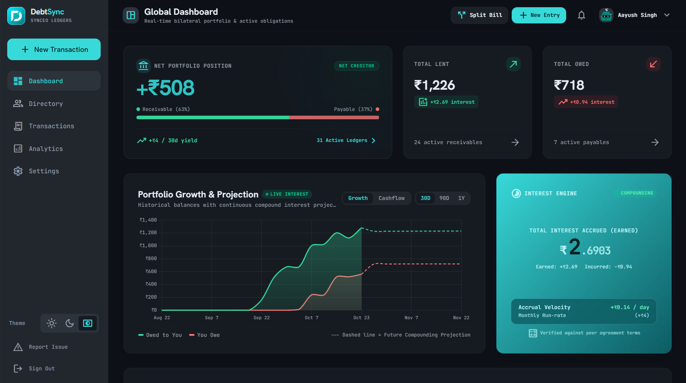
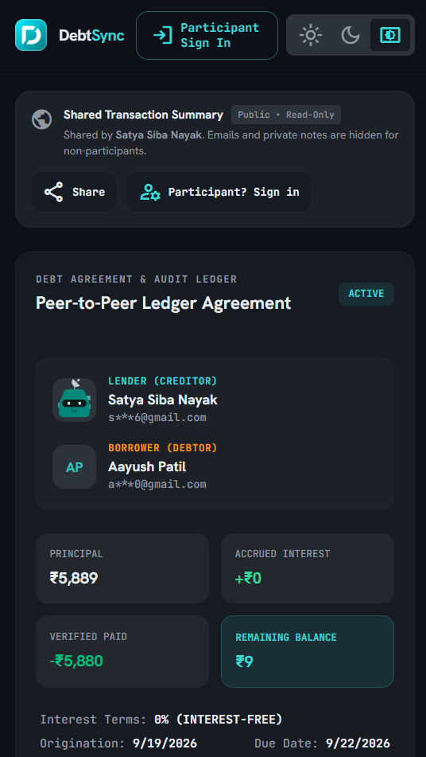

# DebtSync 💸

> **Smart Peer-to-Peer Ledger, Real-Time Interest Accrual Engine & Mutual Debt Consensus Platform.**

[](https://debt-sync.satya-nayak.dev/)
[](https://debt-sync.satya-nayak.dev/share?id=81d9115e-d237-49eb-8be5-16bb3a9ea408&token=gsh_hitjra5bqn7dy2tsdf)
[-000000?style=for-the-badge&logo=next.js)](https://nextjs.org/)
[](https://supabase.com/)

- **Production Website & PWA**: [https://debt-sync.satya-nayak.dev/](https://debt-sync.satya-nayak.dev/)
- **Live Sample Public Receipt**: [Inspect Read-Only Public Share Receipt](https://debt-sync.satya-nayak.dev/share?id=81d9115e-d237-49eb-8be5-16bb3a9ea408&token=gsh_hitjra5bqn7dy2tsdf)
- **Full Technical & Architecture Reference**: [`DOCS.md`](./DOCS.md)
- **UI & Responsiveness Invariants**: [`AGENTS.md`](./AGENTS.md)
- **Support & Inquiries**: [support@satya-nayak.dev](mailto:support@satya-nayak.dev) | [Contact Portal](https://debt-sync.satya-nayak.dev/contact)

---

## ✨ Key Features

### 🤝 Mutual Peer-to-Peer Consensus & Shadow Profiles
- **Bilateral Verification**: Every debt agreement or repayment requires counterparty acceptance/verification before entering active ledger balances (`totalLent`, `totalOwed`, `netPosition`).
- **Shadow / Ghost Accounts**: Record transactions or split bills with anyone via email or phone number before they join. When they register, their historical ledgers automatically merge into their verified account.
- **Equal & Custom Split Bills**: Split group expenses across multiple peers with automatic per-member ledger generation and repayment tracking.

### 📈 Real-Time Interest Accrual Engine
- **Flexible Interest Modes**:
  - `0%` Interest-Free Peer Ledger
  - **Simple Interest**: \(A = P(1 + r \cdot t)\)
  - **Compound Interest**: \(A = P(1 + \frac{r}{n})^{n \cdot t}\) across **Daily**, **Weekly**, **Monthly**, or **Yearly** compounding schedules.
- **Live Sub-Second Accrual Ticker**: Real-time animated ticker showing continuous interest growth down to the second alongside micro-accrual velocity indicators.
- **Smart Avalanche Bulk Settlement**: Allocate lump-sum repayments across multiple active loans with a peer, automatically prioritizing highest-APR obligations first.
- **Multi-Currency Support**: Native INR (`₹`) default with live conversion support for `USD`, `EUR`, `GBP`, and `JPY`.

### 🛡️ Server-Calibrated Network Trust Score (`300–850`)
- **Cross-Device & Cross-User Parity**: Powered by PostgreSQL `SECURITY DEFINER` RPCs (`calculate_user_trust_score` & `get_batch_trust_scores` in `supabase/migrations/027_server_dynamic_network_score.sql`) using UTC calendar dates so every counterparty and device sees the exact same calibrated score without exposing private debt rows.
- **4-Pillar Weighted Algorithm**:
  1. **Repayment Punctuality (`38%`)**: On-time settlements, verified repayments, good-standing bonus, and graduated UTC overdue penalties.
  2. **Principal Clearance & Capital Velocity (`27%`)**: Verified principal repaid vs. borrowed volume + settled lending liquidity.
  3. **Verified Peer Network Breadth (`15%`)**: Unique confirmed counterparties and verified identity badge (`is_verified`).
  4. **Dispute-Free Consensus (`20%`)**: Active dispute deductions, payment dispute tracking, and outbound spam protection.

### 🔗 Dual Cryptographic Sharing System
1. **Participants-Only Link (`/share?id=<uuid>&mode=participants`)**: Restricted strictly to verified agreement participants (`lender`, `borrower`, or split group members).
2. **Global Public Share Receipt (`/share?id=<uuid>&token=gsh_<token>`)**: Read-only proof for outside parties with automatic email masking (`s***k@domain.com`), hidden private notes, disabled mutation controls, and instant token rotation/revocation.

### 🔔 Multi-Channel Notifications, Reminders & PWA
- **Installable Progressive Web App (PWA)**: Standalone mobile & desktop experience with offline-ready caching, safe-area viewport handling, and dark/light theme engine.
- **OS Web Push & Email Alerts**: Instant alerts for new agreements, repayment verifications, and due-date reminders (`1 day` prior to due date).
- **Mandatory Onboarding Safeguards**: Signup enforces explicit RCS/SMS account activity consent (with a strict **no-spam guarantee for non-active accounts**) and requires selecting at least one active notification channel (Email or Device Push).
- **Rate-Limited Support & Bug Reporting**: Built-in PWA Bug Report modal and public Contact Inquiry portal backed by server-only Discord webhooks (rate-limited to `2 inquiries / 24h` per device on the public contact page).

---

## 🖼️ Platform Preview

| Desktop Command Center | Mobile PWA & Public Share Receipt |
| :---: | :---: |
|  |  |

---

## 🛠️ Tech Stack

- **Framework**: [Next.js 16.3](https://nextjs.org/) (App Router, Turbopack, React 19)
- **Database, Auth & Realtime**: [Supabase](https://supabase.com/) (PostgreSQL, Row-Level Security, Edge Functions, Magic Links & OAuth)
- **Styling & Design System**: [Tailwind CSS v4](https://tailwindcss.com/) ("Secure Ledger Aesthetics", Hanken Grotesk & JetBrains Mono)
- **Data Visualization**: [Chart.js](https://www.chartjs.org/) (`react-chartjs-2`) & QR Code generation (`qrcode`)
- **Deployment**: Cloudflare Pages (`@opennextjs/cloudflare`) / Vercel

---

## 🏁 Getting Started

### 1. Clone & Install
```bash
git clone https://github.com/Satya-Siba-Nayak/Debt-Sync.git
cd Debt-Sync
npm install
```

### 2. Configure Environment Variables
Copy `.env.example` to `.env.local` and configure your keys:
```env
# Supabase Configuration
NEXT_PUBLIC_SUPABASE_URL=https://your-project.supabase.co
NEXT_PUBLIC_SUPABASE_ANON_KEY=your-anon-key-here
SUPABASE_SERVICE_ROLE_KEY=your-service-role-key-here

# Canonical App URL
NEXT_PUBLIC_APP_URL=https://debt-sync.satya-nayak.dev

# Optional: VAPID Public Key for Web Push Notifications
NEXT_PUBLIC_VAPID_PUBLIC_KEY=your-vapid-public-key

# Server-Only Discord Webhook (Used by /api/bug-report and /api/contact — NEVER prefix with NEXT_PUBLIC_)
DISCORD_WEBHOOK_URL=https://discord.com/api/webhooks/...

# Optional: Resend API Key for Transactional Email Delivery
RESEND_API_KEY=re_...
EMAIL_FROM=DebtSync <notifications@debt-sync.satya-nayak.dev>
```

### 3. Apply Supabase Migrations
Run the SQL migrations in `supabase/migrations/` (`001_initial_schema.sql` through `028_security_hardening_and_loophole_fixes.sql`) in your **Supabase Dashboard → SQL Editor**.

### 4. Run Development Server & Verify Build
```bash
# Start local development server at http://localhost:3000
npm run dev

# Verify production build (0 TypeScript or Next.js errors)
npm run build
```

---

## 📚 Documentation & Project Structure

```text
Debt-Sync/
├── DOCS.md                  # Comprehensive architecture, algorithm & API reference
├── AGENTS.md                # UI/UX responsiveness, admin isolation & build rules
├── public/
│   ├── screenshots/         # Product showcase screenshots (Desktop & Mobile)
│   └── sw.js                # Web Push & PWA Service Worker
├── supabase/
│   └── migrations/          # PostgreSQL schema, RLS policies & RPC migrations (001–028)
└── src/
    ├── app/
    │   ├── (auth)/          # /login, /signup, /accept
    │   ├── (dashboard)/     # /dash, /transactions, /directory, /analytics, /settings, /admin
    │   ├── api/             # /api/bug-report, /api/contact, /api/notifications, /api/reminders
    │   ├── contact/         # Public Contact & Support Inquiry page
    │   ├── privacy/         # DPDP-compliant Privacy Policy page
    │   ├── share/           # Dual-mode Share & Public Receipt verification page
    │   ├── terms/           # Terms of Service page
    │   └── page.tsx         # Public Landing Page (supports ?home=true session browsing)
    ├── components/          # Layout, Modals, Admin Observatory & Ledger UI components
    └── lib/                 # Supabase clients, Interest Engine, Server Trust Score & Stores
```

---

## 📄 License & Contact

Released under the **MIT License**.  
For support, privacy/data deletion requests, or security disclosures, contact **[support@satya-nayak.dev](mailto:support@satya-nayak.dev)** or visit **[https://debt-sync.satya-nayak.dev/contact](https://debt-sync.satya-nayak.dev/contact)**.
